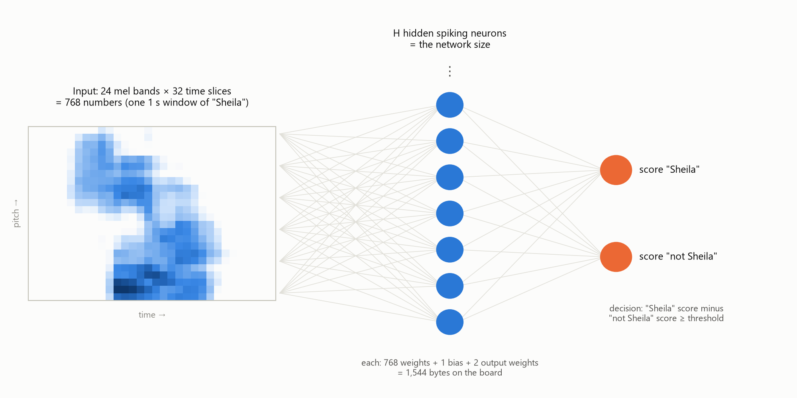
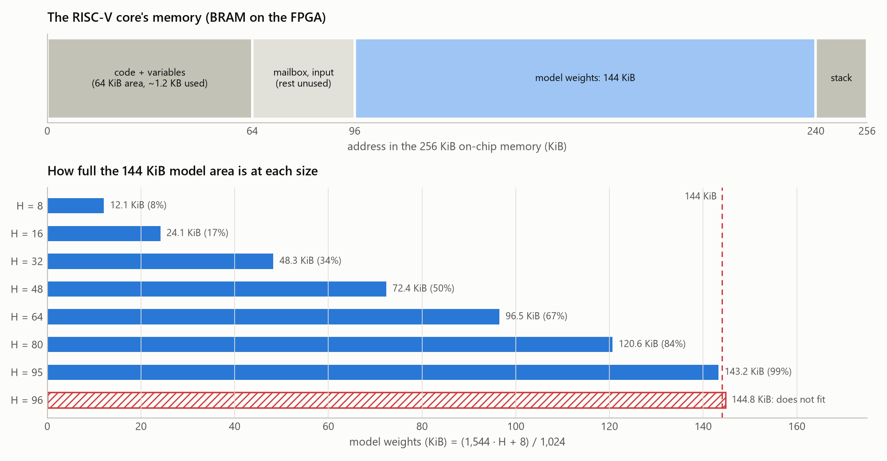

# Network size, explained (background for E2)

This document explains, from the ground up, what "the size of the neural network" means
in this project, why it should change memory, cycles, delay and accuracy, how you change
it, how we measure the effect (the benchmark), and which sizes we test. It assumes no
prior knowledge. The measured results are in the short report
[E2_size_sweep.md](E2_size_sweep.md).

Contents:
1. The system in one picture
2. What a neural network is, and what its "size" is
3. How you change the size
4. Why size changes each metric (memory, cycles, delay, accuracy)
5. The benchmark: how every size is measured the same way
6. The sizes we test, and why
7. What could move the 95-neuron limit
8. How to present this test
9. Glossary

---

## 1. The system in one picture

1. The PC records your voice at 16,000 samples per second. Every **250 ms** (the
   *hop*) it takes the last **1 second** (the *window*) and turns it into a small
   "sound picture", a *mel spectrogram*. It has 24 frequency bands (low to high pitch)
   × 32 time slices (each about 31 ms), so 768 numbers between 0 and 255 (one byte
   each). Bright = much sound energy at that pitch and moment.
2. The PC sends these 768 bytes over the Ethernet cable to the PYNQ-Z2 board.
3. On the board's FPGA runs a small processor, the **PicoRV32 RISC-V core**. It runs
   the neural network on the 768 numbers and returns two scores: "Sheila" and "not
   Sheila". It also reports how many **clock cycles** it needed.
4. If the "Sheila" score wins by more than a threshold in two of three consecutive
   windows (**"2 of 3"**), LED0 lights for one second.

## 2. What a neural network is, and what its "size" is

**A neuron is a small calculator.** It takes many input numbers, multiplies each by a
*weight* (how important that input is, positive or negative), adds everything up, and
adds a *bias* (an offset). The weights and biases are not programmed by hand. They are
learned during **training**, by showing the network tens of thousands of labelled
examples and nudging the weights to reduce its mistakes.

**Our network has three layers:**

| Layer | Size | Fixed or free? |
|---|---|---|
| Input | 768 numbers (the sound picture) | Fixed by the audio frontend |
| Hidden layer | **H spiking neurons** | **Free: this is the "network size"** |
| Output | 2 scores ("Sheila", "not Sheila") | Fixed by the task |

So in this design "the size of the network" means **H, the number of hidden neurons**
(in machine-learning language: the *width* of the hidden layer). The input and output
sizes cannot change without changing the frontend or the task. The deployed model has
H = 95. The original release had H = 64.

**What one hidden neuron does here.** Every hidden neuron is connected to all 768
pixels, with one weight per pixel. You can picture its 768 weights as a *template*, a
24 × 32 pattern. The neuron reacts strongly when the sound picture looks like its
template. One neuron may learn "hiss at high pitch in the first third" (the "sh"),
another "a vowel followed by an L-like sound", another "silence at the end". The
output layer then combines the reactions of all hidden neurons, with 2 weights per
hidden neuron (one per score). **More hidden neurons = more templates the network can
recognise and combine.**

**What makes it "spiking".** Each hidden neuron has a *membrane voltage*. The input
(weighted sum of the 768 pixels, plus bias) is computed once and fed in as a constant
current for **12 time steps** (*current encoding*). At every step the voltage leaks a bit
(×7/8), adds the input current, and when it passes a threshold the neuron fires a
**spike** and the voltage drops back. A strongly matching neuron spikes often (at most
12 times), a weakly matching one rarely or never. The output scores are weighted sums
of the spike counts. This is a *leaky integrate-and-fire* (LIF) neuron.

**Everything is integer arithmetic.** Weights are stored as 16-bit integers ("int16
Q10": the real weight × 1024, rounded). The RISC-V core has no floating-point unit, and
integers make the board's result **bit-exact**: identical to the last bit with a Python
reference implementation (the *integer oracle*). That lets us check the hardware and
compute accuracy in Python on far more examples than we could send to the board.

**How many numbers is that?** Each hidden neuron owns 768 input weights + 1 bias + 2
output weights = 771 numbers; the output layer adds 2 biases. So the network has
**771 · H + 2 parameters**: 6,170 at H = 8, 49,346 at H = 64, 73,247 at H = 95.

## 3. How you change the size

The firmware and the FPGA were written for *any* H, so changing the size needs no C
code and no new bitstream. The pipeline, step by step:

| Step | Tool | What happens |
|---|---|---|
| 1. Train | `train_keyword_snn.py --hidden H` | PyTorch creates an H × 768 weight matrix and trains it (35 epochs, ~10 s on this PC). The last 10 epochs simulate the integer rounding (*quantization-aware training*), so the network learns to work with int16 weights. The checkpoint and the decision threshold with the best **validation** F1 are kept. |
| 2. Tune the live threshold | `tune_stream.py` | Picks the per-window threshold for "2 of 3" on validation windows (at most 0.3% false accepts). |
| 3. Export | `export_model.py` (inside step 4) | Writes `#define MODEL_HIDDEN H` and the weight arrays into C header files. |
| 4. Compile | `research/tools/build_firmware.py` | Builds `keyword.bin` (plain RV32IM) and `keyword_kdot.bin` (with the `kdot` instruction), and **refuses a model that does not fit** the 144 KiB model memory. |
| 5. Run on the board | `bench_board.py` / `run_board.ps1` | Loads the firmware into the FPGA's memory; the same bitstream runs every size. |

The C code simply loops `for (h = 0; h < MODEL_HIDDEN; ++h)`. A bigger H makes those
loops longer and the weight arrays bigger, and nothing else changes. In the benchmark,
one command does all five steps for a size: `size_sweep.py --hidden H` (section 5).

## 4. Why size changes each metric

### 4.1 Memory

Per hidden neuron the board stores:

| What | Count | Bytes each | Bytes |
|---|---|---|---|
| Input weights | 768 | 2 (int16) | 1,536 |
| Bias | 1 | 4 (int32) | 4 |
| Output weights | 2 | 2 (int16) | 4 |
| **Total per neuron** | | | **1,544** |

Plus 8 bytes for the two output biases: **model bytes = 1,544 · H + 8**. Memory grows
in a straight line with H, and 99.5% of it is input weights.

The FPGA gives the processor **256 KiB** of on-chip memory (*BRAM*), shared like this:

| Address range | Size | Used for |
|---|---|---|
| 0x00000–0x0FFFF | 64 KiB | Program code and variables (the code itself is only ~1.2 KB) |
| 0x10400–0x10AFF | ~2 KB | Mailbox to the PC and the 768-byte input |
| **0x18000–0x3BFFF** | **144 KiB = 147,456 bytes** | **The model (weights)** |
| 0x3C000–0x3FFFF | 16 KiB | Stack (working memory) |

1,544 · 95 + 8 = 146,688 bytes fits. 1,544 · 96 + 8 = 148,232 bytes does not, and the
linker refuses ("Model overlaps 16 KiB stack"). So **95 neurons is the largest dense
network that fits: the "memory wall"**. The working memory the network needs while it
runs (membrane voltage, input current and spike count per neuron, 10 bytes each) sits
on the stack and is under 1 KB even at H = 95.

### 4.2 Clock cycles (compute time)

Per inference, for every hidden neuron, the processor does:
1. **768 multiply-adds**: weight × pixel, summed. With current encoding this happens
   once, not at every time step.
2. **12 time steps** of the neuron: leak, add, compare with the threshold, maybe spike.
3. **2 multiply-adds** for the output scores.

All three are per neuron, so **the work grows in proportion to H**. The work that does not
depend on H (reading the request, writing the answer) is tiny.

**Why plain RV32IM is slow.** The PicoRV32 is a very small processor. Every value it
reads from BRAM waits for the memory bus (8 extra cycles), and one multiply-add needs
two reads (weight and pixel), the multiplication, the addition and loop bookkeeping.
That costs about **120 cycles per multiply-add**, so the 768 input weights dominate:
roughly **93,000 cycles per neuron**.

**What `kdot` changes.** `kdot` is a custom instruction Mateo added to the FPGA. A small
coprocessor streams weights and pixels straight from BRAM and does about 4 multiply-adds
per 3 cycles (~0.75 cycles per multiply-add). The input layer becomes ~150× cheaper,
and the 12 neuron time steps become the largest part. That is roughly **4,200 cycles per
neuron**, about 22× fewer.

**From cycles to time.** The clock runs at 100 MHz: one cycle = 10 ns, and 100,000
cycles = 1 ms.

**The real-time limit.** A new window arrives every 250 ms, so one inference must finish
within **25,000,000 cycles**. Otherwise requests pile up and the demo falls behind.
By the per-neuron costs above, plain RV32IM would reach that limit only at about 267
neurons and `kdot` at about 6,000. Both are far beyond the 95 that fit in memory. So for
this design **memory, not time, limits the size**. The sweep checks this prediction.

**A detail the measurements revealed: the compiler.** GCC knows H when it compiles the
firmware.
- For **8 and 16 neurons** it *unrolls* the neuron loop: it writes out the update of
  every neuron one after another. It keeps all the voltages, input currents and spike
  counts in the processor's 31 registers instead of in the slow BRAM.
- From **32 neurons** on there are too many values for the registers, so it compiles a
  normal loop that loads and stores every neuron's state at every time step.
- The effect: with `kdot`, small networks cost about 2,700–2,800 cycles per neuron, larger
  ones about 4,100. With plain RV32IM the difference hardly shows, because the 768
  multiply-adds per neuron dominate.

So the "cost per neuron" belongs to the whole stack (hardware, compiler and code), not to
the network alone. The tool `research/tools/code_shape.py` shows this for every size.

### 4.3 Delay

"Delay" has several parts, and only one of them depends on the network size:

| Part | Depends on H? | Size |
|---|---|---|
| Inference on the RISC-V core | **Yes**, proportional to H | measured: 0.2 ms (H = 8, `kdot`) to 89 ms (H = 95, RV32IM) |
| PC → board → PC round trip (Ethernet, board server, inference) | Through the inference part only | measured: inference + 0.6–1.5 ms |
| Computing the sound picture on the PC | No | measured: 0.4 ms |
| Waiting for the next 250 ms window, plus "2 of 3" confirmation | No | ~0.25–0.5 s after the word ends |

So network size changes only the *processing* part of the delay. With `kdot` that part
stays below 5 ms, small next to the 250 ms hop. Without `kdot` it can take a third of the
hop at the largest size. The delay you notice in the demo (LED after the word) is
dominated by the windowing and the "2 of 3" rule, which are the same for every size.
Experiment E7 measures that end-to-end delay on the live system.

### 4.4 Accuracy (detection quality)

**Capacity.** More hidden neurons = more templates = finer distinctions. The network must
tell "Sheila" apart from "she", "sheet", "shield", "Sheena" and plain "sh", and it must
recognise "Sheila" from thousands of different speakers, speeds and noise levels. Too few
neurons and the network *cannot represent* those differences (**underfitting**): it
misses more real "Sheila"s, accepts more wrong words, or both.

**Diminishing returns.** The first neurons capture the most useful patterns. Later
neurons add finer details that help less and less, so accuracy usually rises quickly
and then **flattens**. Where it flattens is what this experiment measures.

**Overfitting.** A network with many parameters can memorise its training speakers
instead of learning the word. We have 1,606 "Sheila" training clips. Weight decay, noise
added during training, and choosing the checkpoint on separate validation speakers keep
this in check. In our size range we expect capacity to matter more than overfitting.

**Harder task, more capacity?** The deployed model is also trained on *hard
negatives*: edited real "Sheila" recordings that are *not* the keyword ("sh", "shee",
"sheet", "sh" + another word, …). That task is harder than separating "Sheila" from 34
unrelated words, so it may need more neurons. Earlier runs hinted at this: 95 neurons
beat 64 neurons on live detection (61% vs 54%). E2 tested it with seven sizes and found
that the 64-neuron result was a dip, not a trend (see the report).

**Two kinds of mistakes, and a fair comparison.** A *miss* is a "Sheila" that is not
detected; a *false accept* is something else that is detected. A threshold trades one
against the other. Every model, at every size, gets its **own** thresholds, chosen on
validation data by the same rule. So every size is compared at its own best operating
point, never with a threshold tuned for another size.

## 5. The benchmark: how every size is measured the same way

### 5.1 Principles
1. **Same inputs for every model.** Every model is scored on exactly the same files. Their
   SHA-256 fingerprints are stored (`results/E2/benchmark_inputs.json`), and every
   result file carries the fingerprint, so results from different inputs are never mixed.
2. **Choices on validation, reporting on test.** Speech Commands is split by speaker:
   training (84,843 clips), validation (9,981) and test (11,005), with no speaker in
   two splits. Thresholds, checkpoints and "best seed" use validation only. The test set is
   only used to report. Choosing anything on the test set would flatter the results.
3. **Three seeds per size.** Training starts from random weights and sees the data in
   random order. The *seed* fixes that randomness. Each size is trained with seeds 0, 1
   and 2, and we report the mean ± standard deviation. A difference smaller than that
   spread is not a real difference.
4. **Latency only from the real board, and only if bit-exact.** Cycle counts come from
   the RISC-V core's own timer, never from estimates. Before a cycle count is accepted,
   the board's scores and spike counts must equal the integer oracle exactly.
5. **One command per size**, so nothing is done by hand differently from one size to the
   next.

### 5.2 What it measures

**Quality** (`eval_model.py`, integer oracle = the board's exact arithmetic):

| Measurement | Data | Why |
|---|---|---|
| Clip precision, recall, F1, false-positive rate | 11,005 test clips (212 "Sheila") | The standard machine-learning score, comparable with all earlier reports |
| Live stream: "Sheila" detected, other words accepted (single window and "2 of 3") | 212 "Sheila" + 3,000 other test clips, each placed in 2.25 s of background noise and cut into 1 s windows every 250 ms, like the demo | Closest to what you experience in the live demo |
| Hard negatives passing the live threshold | 1,710 test-split windows cut from real "Sheila" recordings: sh, shee, sheet, sh + other word, shee + other word, other onset + "eila", "eila" alone, noise (+ whole-word positives) | The near-miss sounds the model must reject |
| Synthesized words ("2 of 3") | 672 utterances, 27 words, 2 Windows voices × 4 speeds × 3 pitches, never used in training | Near-miss words (she, sheet, shield, Sheena, Shayla, Leila, …) and unrelated words |
| Background noise | 398 one-second windows from 6 noise recordings | False alarms with nobody speaking |
| Validation versions of clips, live stream and hard negatives | 9,981 clips, 204 + 3,000 live clips, 1,544 windows | The only numbers used for choices |
| Hidden spikes per clip | test clips | How active the network is (a rough energy indicator) |

**Cost** (`bench_board.py`, real board):

| Measurement | How | Why |
|---|---|---|
| Model bytes | Size of the compiled `.model` section, vs 147,456 | The memory limit |
| Cycles (min / mean / max) | 40 fixed input vectors × 3 repeats, timer on the RISC-V core, for plain RV32IM and for `kdot` | The time limit (25 M cycles) |
| Bit-exact check | Board scores, spikes and decision vs the integer oracle, all 120 requests | Proves the measurement and the oracle are trustworthy |
| "2 of 3" check | 4 fixed sequences of positive/negative windows, 250 ms apart | The live decision logic still works |
| Round trip | PC timer around each request | The delay the PC sees per window |
| PC feature time (once) | `features.py` on 300 one-second windows | The PC part of the delay |

### 5.3 How it is built
- `research/tools/size_sweep.py` is the benchmark you run. For each size and seed it
  trains, tunes the live threshold, runs `eval_model.py` and runs `bench_board.py`. It
  writes everything to `research/results/E2/` and skips work already done.
- `eval_model.py` reuses the project's existing evaluation code (`confusables.py`,
  `tune_stream.py`, `robustness.py`), so E2 numbers mean the same as all earlier ones.
- `bench_board.py`:
  - compiles the firmware;
  - copies it to the board and checks its fingerprint there;
  - restarts the board server with it, once with each firmware variant;
  - runs the checks of `check_board.py`.
- **Calibration.** Before the sweep, the benchmark was run on the deployed model and
  compared with its stored evidence. All 73 stored quality values matched exactly, and the
  board gave identical cycle counts (max 8,877,865 / 395,945). So the benchmark
  measures exactly what the earlier evidence measured.

### 5.4 Why scoring in Python is as good as scoring on the board
The board computes exactly the same integers as the Python oracle. The benchmark checks
this for every model, on both firmware variants. Scoring ~80,000 windows per model in
Python therefore gives the same answers the board would give, in seconds instead of
hours.

### 5.5 Why your own recordings are not needed for this test
- The question is how the sizes compare *with each other*. That needs identical test
  data for every size, not necessarily your voice.
- The test data is far larger than what one person can record:
  - 212 "Sheila" clips from speakers never heard in training;
  - 10,793 other words;
  - 1,710 near-miss windows;
  - 672 computer-voice words.
- Recordings of your voice and microphone are valuable for realism, and experiment E1
  does them properly: two sessions on different days, the second kept for testing only.
  The benchmark can be re-run on them later without retraining anything.
- Leaving them out has a cost, and the report says so: your microphone and room are not
  represented, so the absolute numbers may differ in your live demo.

## 6. The sizes we test, and why

| H | Model bytes | Share of the 144 KiB model memory | Why this size |
|---|---|---|---|
| 8 | 12,360 | 8% | Tiny. Shows where the network breaks down, and the smallest possible cost. |
| 16 | 24,712 | 17% | Small. Expected on the steep part of the accuracy curve. |
| 32 | 49,416 | 34% | Half the original release. Often enough for one keyword if accuracy saturates early. |
| 48 | 74,120 | 50% | Between 32 and 64, to locate the "knee" where accuracy flattens. |
| 64 | 98,824 | 67% | The original release size. Links this study to all earlier results. |
| 80 | 123,528 | 84% | Between 64 and the wall: is accuracy still rising near the limit? |
| 95 | 146,688 | 99.5% | The largest that fits. This is the model you chose and deployed. |

- All seven fit the memory. Even without `kdot`, the slowest (95) needs about 89 ms per
  window, about a third of the 250 ms budget. So every size runs on the board, live.
- Spacing: roughly doubling at the small end (8 → 16 → 32 → 64), where changes are
  expected to be large, and finer steps near the top, where we must decide whether the
  last neurons are worth their memory.
- Why seven sizes and not "a couple": training takes ~10 s and the board benchmark ~75 s
  per model. Seven sizes × 3 seeds = 21 models cost about half an hour, and give curves
  you can trust instead of two or three points.
- Why not 96 or more: it does not fit the model memory with int16 weights (section 7).
  Why not below 8: 8 neurons already shows the low end.

## 7. What could move the 95-neuron limit

The memory wall is a property of the current design, not a law of nature. Ways to move
it (not part of E2):
- **int8 weights** (experiment E6): 1 byte per weight instead of 2, so ~776 bytes per
  neuron and ~190 neurons. `kdot` reads int16 weights, so int8 needs the plain loop or a
  `kdot8` variant of the coprocessor.
- **A different memory map:** the 64 KiB code area holds only ~1.2 KB of code. Starting
  the model right after the input buffer (a linker-script change) would give room for
  about 114 neurons.
- **More BRAM:** the design uses 64 of the 140 BRAM blocks of the PYNQ-Z2's FPGA (Zynq
  XC7Z020). A larger memory needs an RTL change and a Vivado rebuild. Beyond ~267
  neurons the 250 ms real-time limit would then bind for plain RV32IM, but not with
  `kdot`.
- **A different topology** (E3/E4): temporal networks reuse a small set of weights at
  every time step and need about 30× fewer weights per neuron.

## 8. How to present this test

**Suggested slides:**
1. *Question.* How does network size trade off detection quality against memory and
   latency on a small RISC-V core?
2. *What "size" means.* The 768 → H → 2 diagram and the two formulas: bytes =
   1,544·H + 8, cycles ≈ a·H. One neuron = one 24 × 32 template.
3. *Method.* One factor changed (H), everything else fixed; 3 seeds; validation for
   choices, test for reporting; latency from the board's timer, bit-exact checked; one
   benchmark command, calibrated against stored evidence.
4. *Cost vs size.* Memory and cycles grow linearly. The memory wall at 95 neurons comes
   long before the time wall.
5. *Quality vs size.* Where accuracy flattens, and what the last neurons buy.
6. *Trade-off and delay.* The Pareto plot and the delay breakdown, then a conclusion and
   recommendation.

**What E2 found (the one-minute version).** Details and figures:
[E2_size_sweep.md](E2_size_sweep.md).
1. Memory and cycles grow in a straight line with H, exactly as the formulas predict.
2. The 144 KiB memory stops the network at 95 neurons. At that size it uses only 35% of
   the time budget without `kdot`, and 1.6% with it.
3. Quality jumps from 8 to 16 neurons and then stays flat up to 95, within the seed
   spread. 48 neurons is the efficient size: as good as 95 at half the memory and cycles.
4. No size fixes the near misses ("Sheena", "shield", "shee" + another word pass about a
   third of the time at every size). That is a limit of the dense design, which is why E3
   and E4 try time-aware networks.
5. Size changes only milliseconds of processing delay. What a user notices is set by the
   window, the hop and the "2 of 3" rule.

**Questions you may get, and how to answer them:**
- *"Why not just use the biggest network?"* The memory wall stops us at 95. Below that,
  extra neurons cost memory and cycles for a gain that shrinks as the network grows. The
  report shows how much each step buys.
- *"Why the error bars?"* Training is random. Three seeds show how much results move by
  chance alone; differences inside that spread are not real.
- *"Why is test F1 not the same as validation F1?"* Validation includes the hard
  near-miss variants (harder), and the best seed was chosen on validation, which flatters
  it slightly. Test is only reported.
- *"Does the size change the delay the user notices?"* Hardly. With `kdot` the network
  needs a few ms, while the window, hop and "2 of 3" add 0.25–0.5 s regardless of size.
- *"How do you know the board computes what Python computes?"* Every model is checked:
  120 requests per firmware variant, scores and spike counts identical to the last bit.
- *"Why no energy numbers?"* Nothing measured power. Cycles and spike counts are only
  indirect indicators, and we say so.

## 9. Glossary

| Term | Meaning |
|---|---|
| Neuron | A unit that sums weighted inputs; here a spiking (LIF) neuron |
| Weight, bias | Learned numbers: the importance of each input, and an offset |
| Hidden layer, H | The neurons between input and output; H = their number = the network size here |
| Parameter | Any learned number (weights and biases); here 771·H + 2 |
| Training, epoch | Learning the weights from labelled examples; one epoch = one round of 16,384 examples |
| Seed | The number that fixes training's randomness; different seeds give slightly different networks |
| Quantization, int16, Q10 | Storing weights as 16-bit integers (real value × 1024) |
| Integer oracle, bit-exact | The Python reference of the board's arithmetic; "bit-exact" = identical results |
| BRAM, KiB | On-chip FPGA memory; 1 KiB = 1,024 bytes |
| Cycle, 100 MHz | One tick of the processor clock; 100 million per second, so 10 ns each |
| RV32IM | The plain RISC-V instruction set of the PicoRV32 (integers, multiply) |
| `kdot` | The custom dot-product instruction (coprocessor) added for this project |
| Inference | Running the trained network once on one window |
| Window, hop | The 1 s of audio analysed; the 250 ms between windows |
| "2 of 3" | A window counts only if one of the two previous windows also passed |
| Precision | Of all detections, the share that really were "Sheila" |
| Recall | Of all real "Sheila"s, the share that was detected |
| F1 | One number combining precision and recall (their harmonic mean) |
| False-positive rate (FPR) | Share of other words wrongly detected |
| Near miss, hard negative | A sound that resembles the keyword but is not it (sh, she, sheet, …) |
| Validation / test split | Data for choosing / data only for reporting, from different speakers |
| Underfitting / overfitting | Too little capacity to learn / learning the training data by heart |
| Pareto front | The designs that cannot be improved in one metric without losing in another |
