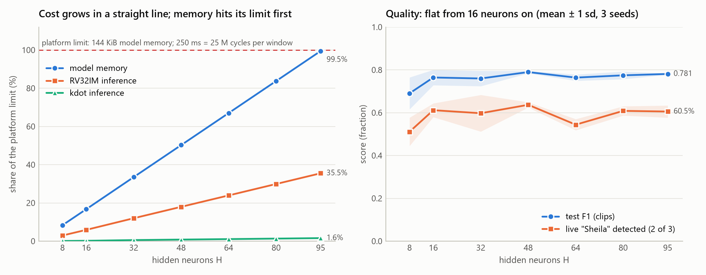
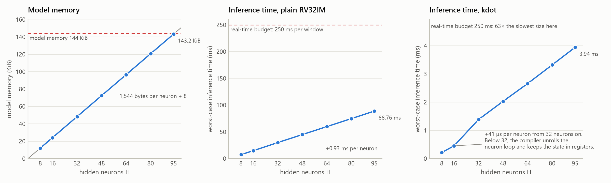
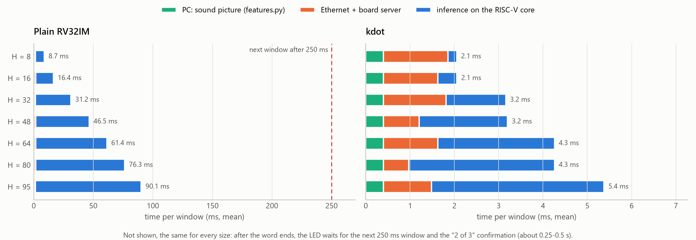
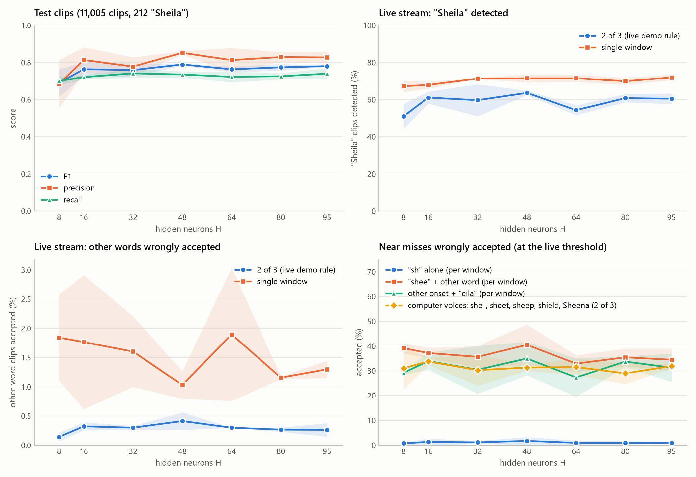
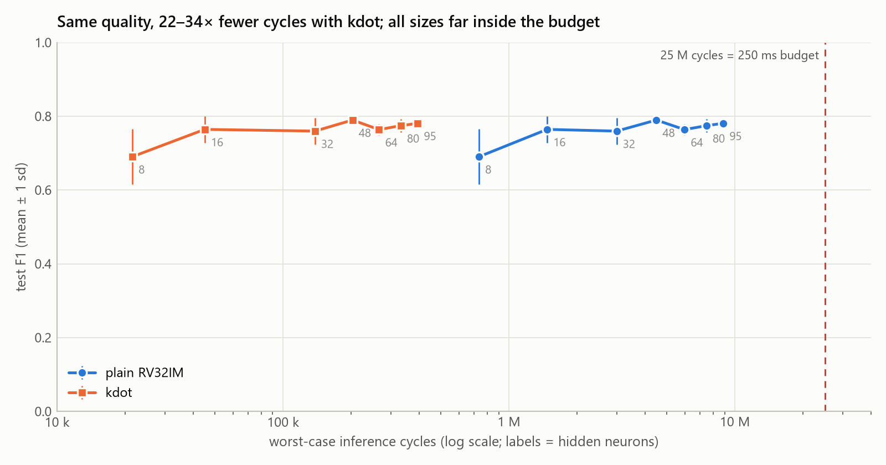

# E2 — Network size sweep (dense network, current encoding)

*Date:* 2026-10-04 · *Branch/commit:* Pedro, on top of b7c1e04 (the deployment of the 95-neuron
model) · *Wall time of the sweep:* 30 min (training 3.5 min; tuning, evaluation and board
measurements 26 min). Tool building and calibration came before it.

Background for readers new to the project: [E2_network_size_explained.md](E2_network_size_explained.md).

## Summary

| | |
|---|---|
| **Cost is a straight line in H** | Memory: 1,544 bytes per neuron. Plain RV32IM: 93,340 cycles (0.93 ms) per neuron. `kdot`: 4,056 cycles (41 µs) per neuron, and less below 32 neurons, where the compiler unrolls the neuron loop. |
| **Memory is the limit that binds** | 95 neurons fill 99.5% of the 144 KiB model memory but use only 35.5% (RV32IM) or 1.6% (`kdot`) of the 250 ms real-time budget. Time alone would allow about 267 or 6,000 neurons. |
| **Quality stops improving at about 16 neurons** | Test F1 0.69 (8) → 0.76 (16), then 0.76–0.79 up to 95. Live "Sheila" detection ("2 of 3") 51% → 61%, then 54–64%. Above 16 the differences are within the seed spread. |
| **Efficient size: 48 neurons** | Chosen by the pre-set validation rule: best mean validation F1 (0.740 ± 0.003). On test it equals 95 within the seed spread, with half the memory and half the cycles. It detects slightly more (F1 0.790 vs 0.781; live 64% vs 61%) and also accepts slightly more (other words 0.41% vs 0.26%). |
| **Bigger does not fix near misses** | At every size from 8 to 95: "shee" + another word is accepted 33–41% of the time, another onset + "eila" 27–35%, synthesized she- words 29–34%. The near-miss problem is a limit of the dense, order-blind design, not of its size (→ E3/E4). |
| **Delay: size changes only the processing part** | Round trip 1.7–5.0 ms with `kdot` and 8–90 ms with RV32IM. The window, hop and "2 of 3" rule (0.25–0.5 s after the word) are the same for every size. |



## 1. Question and hypothesis
*Written on 2026-10-04 before any E2 model was trained.*

**Question.** How does the number of hidden neurons *H* of the deployed design
(dense 768→H→2 LIF network, current encoding, Sheila hard negatives) change model memory,
RISC-V cycles, processing delay and detection quality? Which platform limit stops the
network from growing?

**Hypotheses** (the numbers come from the code and from the two sizes already measured on
the board, 64 and 95 neurons):
1. **Memory** grows exactly linearly: 1,544 bytes per neuron (768 int16 input weights,
   one int32 bias, two int16 output weights) plus 8 bytes. 95 neurons is the largest size
   that fits the 147,456-byte model region.
2. **Cycles** grow linearly, with almost no fixed part: about 93,450 cycles per neuron with
   plain RV32IM and about 4,170 with `kdot`. Every size up to 95 stays far inside the
   25,000,000-cycle (250 ms) budget. RV32IM would reach it only near 267 neurons and `kdot`
   near 6,000, so **memory, not time, limits the size** of this design.
3. **Delay.** The PC ↔ board round trip is the inference time plus about 1 ms. Only the
   inference part depends on *H*; the window, hop and "2 of 3" confirmation do not.
4. **Quality** rises steeply from 8 to about 32 neurons and then flattens (diminishing
   returns). Because hard negatives make the task harder, the largest sizes may still gain
   a little: in round 2 (JOURNAL entry 10), 64 → 95 neurons gave test F1 0.764 → 0.781 and
   live "2 of 3" recall 54% → 61%. Differences between neighbouring large sizes are
   expected to be within the seed spread.
5. **Near misses.** Small networks pay for the same validation false-accept budget with
   lower recall and more accepted near-miss sounds (sh, shee, sheet, "she-" words).

## 2. What was changed and what was held constant
| Changed | Values |
|---|---|
| Hidden neurons *H* | 8, 16, 32, 48, 64, 80, 95 |
| Seed | 0, 1, 2 for every size (21 models) |

Held constant, identical to the deployed model (JOURNAL entries 10–11):
- data: Speech Commands v0.02 official split; `data/augment.npz` hard negatives (all nine
  kinds) at fraction 0.3 of each class's half-batch;
- training: 35 epochs, last 10 quantization-aware, AdamW lr 0.002 (cosine), weight decay
  1e-3, batch 256, 16,384 samples per epoch;
- network: current encoding, 12 time steps, leak 7/8, int16 Q10 weights;
- frontend: 24×32 mel, 1 s window, 250 ms hop;
- threshold rules: decision threshold = best validation F1 (validation clips plus
  validation variants); stream threshold = lowest with ≤ 0.3% confirmed false accepts on
  validation live windows (`tune_stream.py`);
- firmware C code, bitstreams, compiler (Vitis 2026.1 GCC 13.4), board, and the
  benchmark inputs (fingerprinted in `results/E2/benchmark_inputs.json`).

*Added after the measurements:* two things changed along with *H* without being chosen:
- the code the compiler generates (section 4.2);
- the training time, 7.3 s at 8 neurons and 11.0 s at 95.

Both are recorded, not controlled.

## 3. Setup
- **Commands** (repository root): `size_sweep.py` runs the benchmark, `plot_size_sweep.py`
  makes the tables and figures, `code_shape.py` inspects the compiled code.
  ```powershell
  .venv/Scripts/python.exe code/snn_keyword/research/tools/size_sweep.py --hidden 8 16 32 48 64 80 95
  .venv/Scripts/python.exe code/snn_keyword/research/tools/code_shape.py --out code/snn_keyword/research/results/E2/compiled_code.json
  .venv/Scripts/python.exe code/snn_keyword/research/tools/plot_size_sweep.py
  ```
  For each size, `size_sweep.py`:
  1. trains seeds 0–2 with `train_keyword_snn.py --encodings current --aug-fraction 0.3 --hidden H`;
  2. tunes the stream threshold with `tune_stream.py`;
  3. scores the models with `eval_model.py`;
  4. measures them with `bench_board.py`, for both firmware variants.

  A re-run skips finished steps.
- **Training:** 21 runs on the CPU (Ryzen 5 7600X, PyTorch 2.11.0+cpu, deterministic),
  7.3–11.0 s each.
- **Board:**
  - PYNQ-Z2 (PYNQ Linux 3.0.1, 100 MHz) with the release bitstreams: `keyword.bit` for
    RV32IM and `keyword_kdot.bit` for `kdot`;
  - firmware from `build_firmware.py` (Vitis 2026.1 GCC 13.4, `-O3`);
  - the same 40 input vectors × 3 for every model (`results/sheila_hardneg/verification_vectors.npz`),
    compared bit for bit with that model's integer oracle, plus the four "2 of 3" patterns.
- **Checks before the sweep:**
  - Calibration on the deployed model: `eval_model.py` reproduced all 73 stored quality
    values exactly, and `bench_board.py` the stored cycle counts (max 8,877,865 / 395,945).
  - Reproducibility: the retrained 64- and 95-neuron models are weight-for-weight
    identical to the round-2 runs (all seeds). The 95-neuron seed 2 *is* the deployed model.
- **Deviations from PLAN.md E2:**
  1. The recipe includes hard negatives: you chose that model before this experiment, and
     the plan predates hard negatives.
  2. Sizes 48 and 80 were added, which is cheap and resolves the shape of the curve.
  3. Validation F1 includes the validation hard-negative variants (the deployed model's
     selection metric), so it is lower than plain clip F1.
  4. Your own recordings do not exist yet (E1). Near misses are measured with the
     hard-negative variants and the synthesized words.

## 4. Results
All 21 models are **bit-exact** on the board with both firmware variants (120 of 120
requests each), and every "2 of 3" pattern passed. Values are mean ± sample sd over seeds
0–2. Full data: `results/E2/summary.csv` (per size) and `models.csv` (per model).

### 4.1 Cost

| H | Model bytes (% of 144 KiB) | Max cycles RV32IM (ms, % of budget) | Max cycles `kdot` (ms) | Round trip RV32IM / `kdot` (ms) | Neuron loop in the code |
|---|---|---|---|---|---|
| 8 | 12,320 (8.4%) | 736,500 (7.4 ms, 2.9%) | 21,533 (0.22) | 8.3 / 1.7 | unrolled, state in registers |
| 16 | 24,640 (16.7%) | 1,474,610 (14.7 ms, 5.9%) | 45,039 (0.45) | 16.0 / 1.7 | unrolled |
| 32 | 49,408 (33.5%) | 2,995,473 (30.0 ms, 12.0%) | 138,433 (1.38) | 30.8 / 2.8 | loop |
| 48 | 74,112 (50.3%) | 4,488,541 (44.9 ms, 18.0%) | 202,957 (2.03) | 46.1 / 2.8 | loop |
| 64 | 98,816 (67.0%) | 5,979,988 (59.8 ms, 23.9%) | 265,860 (2.66) | 61.0 / 3.9 | loop |
| 80 | 123,520 (83.8%) | 7,474,638 (74.7 ms, 29.9%) | 331,966 (3.32) | 75.9 / 3.9 | loop |
| 95 | 146,680 (99.5%) | 8,876,298 (88.8 ms, 35.5%) | 394,378 (3.94) | 89.7 / 5.0 | loop |

Between the seeds of one size the cycle counts differ by at most 0.1% (RV32IM) and 3.5%
(`kdot`): only the number of spikes changes. The PC needs 0.40 ms (median) to compute one
sound picture.



### 4.2 What the cost numbers show (hypotheses 1–3)
1. **Memory: confirmed.** The measured `.model` section is within 72 bytes of
   1,544·H + 8. The difference: the compiler builds the tiniest arrays (output weights and
   biases) into the instructions instead. 95 neurons use 146,680 of 147,456 bytes; 96 would
   need 148,232 and do not fit.
2. **Cycles: confirmed, with one surprise.**
   - From 32 neurons on, straight lines fit almost perfectly:
     - RV32IM: 93,340 cycles per neuron + 7,900 (R² = 0.999999);
     - `kdot`: 4,056 cycles per neuron + 7,950 (R² = 0.9997).

     That is within 0.1% and 3% of the predictions.
   - **The surprise:** at 8 and 16 neurons `kdot` costs only 2,690 and 2,815 cycles per
     neuron. GCC knows H when it compiles. For 8 and 16 it unrolls the neuron loop (8 and
     16 copies of the membrane update; from 32 on, one loop; `results/E2/compiled_code.json`)
     and keeps the neuron state in registers instead of the slow BRAM. RV32IM hardly
     notices, because its 768 multiply-adds per neuron dominate.
   - So the "cost per neuron" is a property of hardware, compiler and code together.
   - The budget would allow 267 neurons (RV32IM) or about 6,160 (`kdot`); memory stops at 95.
3. **Delay: confirmed.** Round trip = inference + 0.6–1.5 ms. With `kdot` the round trip
   rises in steps of about 1.1 ms (1.7 → 2.8 → 3.9 → 5.0 ms). The board server checks for
   the answer about once per millisecond, so that polling sets the round trip as much as the
   network does.



### 4.3 Quality

| H | Val F1 | Test F1 | Test precision / recall | Test FPR | Live 2 of 3: "Sheila" / other words | "sh" windows | "shee" + word | onset + "eila" | Synth. she- words (2 of 3) |
|---|---|---|---|---|---|---|---|---|---|
| 8 | 0.643 ± 0.050 | 0.690 ± 0.074 | 0.686 / 0.701 | 0.67% | 51.1 ± 6.6% / 0.14% | 0.8% | 39.1% | 29.2% | 31.0% |
| 16 | 0.708 ± 0.024 | 0.764 ± 0.036 | 0.814 / 0.722 | 0.33% | 61.2 ± 3.2% / 0.32% | 1.4% | 37.2% | 33.9% | 33.8% |
| 32 | 0.720 ± 0.030 | 0.760 ± 0.036 | 0.779 / 0.742 | 0.42% | 59.8 ± 8.6% / 0.30% | 1.2% | 35.7% | 30.4% | 30.3% |
| **48** | **0.740 ± 0.003** | **0.790 ± 0.006** | 0.853 / 0.736 | 0.25% | **63.7 ± 1.2%** / 0.41% | 1.7% | 40.5% | 35.0% | 31.3% |
| 64 | 0.725 ± 0.014 | 0.764 ± 0.015 | 0.813 / 0.723 | 0.34% | 54.4 ± 2.6% / 0.30% | 1.0% | 32.9% | 27.4% | 31.5% |
| 80 | 0.740 ± 0.017 | 0.775 ± 0.018 | 0.830 / 0.726 | 0.29% | 60.9 ± 2.2% / 0.27% | 1.0% | 35.5% | 33.7% | 29.0% |
| 95 | 0.730 ± 0.013 | 0.781 ± 0.003 | 0.828 / 0.741 | 0.30% | 60.5 ± 2.8% / 0.26% | 1.0% | 34.5% | 31.3% | 31.9% |

How to read it:
- "Live" = 212 "Sheila" + 3,000 other test clips in background noise, at the demo's 250 ms
  hop.
- The near-miss columns give the share of windows (or utterances) accepted at the live
  threshold.
- Background noise: one false detection in 1,194 windows at 8 neurons (one seed), none at
  any other size.
- Mean hidden spikes per clip: 15 (8 neurons) to 41 (48). Per neuron, activity falls from
  1.8 to 0.4 spikes as the network grows.



### 4.4 What the quality numbers show (hypotheses 4–5)
4. **Quality: partly confirmed.**
   - The steep part ends at 16 neurons, earlier than the predicted 32. From 8 to 16:
     validation F1 0.643 → 0.708, test F1 0.690 → 0.764, live detection 51% → 61%.
   - Above 16, no size is reliably better than another. The pre-set rule (smallest size
     whose mean validation F1 is within one sd of the best) picks **48**, which also has
     the best mean validation F1.
   - On test, 48 is not better than 95 in every respect. It detects a little more but
     also accepts a little more: other words 0.41% vs 0.26%, "shee" + word 40.5% vs 34.5%.
     Each of these differences is within about one seed sd.
   - The round-2 hint that 95 beats 64 does not generalise. 64 is a dip, worse on live
     detection (54%) than both 48 (64%) and 80 (61%), for all three seeds; with three
     seeds this may be chance.
5. **Near misses: not confirmed.** Near-miss acceptance does not depend on size. From 8
   to 95 neurons:
   - "shee" + another word stays at 33–41%;
   - another onset + "eila" at 27–35%;
   - synthesized she- words at 29–34%;
   - plain "sh" at 1–2%.

   Small networks lose recall, but they do not let more near misses through.



## 5. Interpretation
- **Which limit binds.** For this design, memory. The largest network that fits (95) uses
  only 35.5% of the real-time budget without `kdot` and 1.6% with it.
- **Does the limit hurt?** No. Quality saturates long before the wall: almost all of it is
  there at 16 neurons (17% of the memory), and 48 neurons (50%) are equivalent to 95
  within the seed spread. The memory wall does not cost this design any measurable quality.
- **What does limit quality** is the design itself. One dense layer sees the whole second
  at once and cannot follow the order of sounds. That is why "Sheena", "shield" or "shee" +
  another word pass about a third of the time at *every* size. More neurons give more of
  the same templates, not a sense of order. This is the central argument for E3
  (temporal encoding) and E4 (temporal convolution).
- **Trade-off.**
  - Going from 95 to 48 neurons halves memory (146,680 → 74,112 bytes) and inference time
    (88.8 → 44.9 ms RV32IM, 3.9 → 2.0 ms `kdot`) at equal quality.
  - Going down to 16 neurons cuts both by a further 3–4.5× for a few points of F1
    (validation 0.708 vs 0.740).
  - With `kdot` the time saving is invisible to a user (milliseconds against the 0.25–0.5 s
    of windowing and confirmation). The real gain is **freed memory** for other uses.
- **Seeds matter as much as size above 16.** At 32 neurons live detection ranges from 50%
  to 66% between seeds. Choosing the seed on validation data is part of the design.
- **Recommendation.**
  - Keep the deployed 95-neuron model for now: it works, and a 48-neuron model would be
    no better for the user.
  - Use **48 neurons** as the efficient dense reference in later experiments.
  - Use **16 neurons** when memory must be minimal.

## 6. Threats to validity
- Only three seeds. The spread between seeds is as large as the size effect above 16, so
  single differences (such as the dip at 64) may be chance.
- One training recipe, tuned for 64–95 neurons. Smaller or larger networks might do better
  with other learning rates or more epochs.
- 212 "Sheila" test clips: one standard error of recall is about 3 percentage points.
- The live stream and near-miss sets are built, not spoken:
  - clips placed in recorded noise;
  - edited real recordings;
  - two Windows voices.

  Your microphone and room are not represented (E1).
- Cycles are the observed maximum over 40 fixed vectors, not a proven worst case. They
  depend on BRAM wait states and on what the compiler generates.
- The round trip includes the board server's 1 ms polling; it is not a pure network
  measurement.
- Model bytes count the `.model` section only. The ≤ 72 bytes the compiler moves into the
  code are not counted.
- Clip and window rates are not false alarms per hour of real speech.

## 7. Artefacts
- `research/results/E2/` (the per-model files sit in subfolders):
  - `summary.json`, `summary.csv`, `models.csv`;
  - `fig_*.png`;
  - `quality/h<H>.json` (all quality metrics, test and validation);
  - `board/h<H>_seed<s>.json` (bit-exactness, cycles, round trips, firmware hashes);
  - `training/` (training and stream-threshold histories);
  - `models/` (the 21 integer models);
  - `benchmark_inputs.json` (input fingerprint `c11137528abcc8fe`);
  - `pc_timing.json`;
  - `compiled_code.json`.
- Tools in `research/tools/`:
  - `size_sweep.py` (the benchmark), `eval_model.py`, `bench_board.py`;
  - `benchmark_inputs.py`, `code_shape.py`, `plot_size_sweep.py`;
  - `start_board.sh` gained an optional firmware path.
- Ignored by git: training runs in `code/snn_keyword/runs_e2/`, firmware builds in
  `code/snn_keyword/build/bench/`.

## 8. Consequences for the plan
- **E3** should use **16 and 48** neurons instead of the default 16 and 64. 16 is where the
  quality plateau starts; 48 is the efficient dense size; 64 turned out to be a dip.
- **E3/E4** must beat the dense near-miss rates (about 35% for "shee" + word, about 31%
  for she- words), because size alone does not move them.
- **E6** (int8 weights) would let larger dense networks fit, but E2 gives no reason to
  expect them to be better. E6 should instead measure memory saved at equal quality, or
  room made for time-aware topologies.
- **Reuse:** `eval_model.py` and `bench_board.py` serve every later experiment, once new
  model kinds have an integer oracle.
